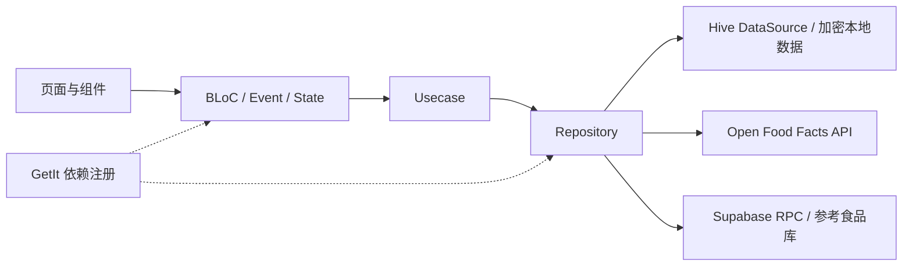

# M0 技术审计：OpenNutriTracker 中国用户版本

审计日期：2026-10-14（北京时间）。审计对象：稳定版 v2.4.0+66，提交 `8d2420f0305c96a4f798f3a111509827260f6df7`。

## 结论及验收边界

建议保留 Flutter/Dart、现有 BLoC、GetIt、Hive CE、食品接口适配、日记快照和计算工具，在现有功能模块内逐步改造。原版已经有统一 Material 3 主题、深色模式、中文界面、合并搜索、简单/高级录入、照片、营养素模型和 JSON/CSV 导入导出，不需要从零重写。

**本轮完成源码审计、仓库基线和公开接口样本核验；没有建立本机可运行基线。** 用户明确选择本轮不安装 Flutter SDK，且没有 Supabase 配置。因此未执行依赖解析、代码生成、Flutter analyze/test、Android 构建、安装或 App 实际交互；不把上游 CI 成功替代本机测试。M0 等待用户验收；M1 仅交付工作安排，尚未开始界面设计或正式 UI 改造。

主要差距是食品可信度与收藏模型、国内食品数据完整性、完整备份，以及食品编辑页中混杂的计量和校验逻辑。对用户数据有影响的缺陷应先建立回归用例，再修复；本轮不修复业务代码。

## 1. 仓库、分支与版本

| 项目 | 实际状态 |
| --- | --- |
| 上游 | [simonoppowa/OpenNutriTracker](https://github.com/simonoppowa/OpenNutriTracker) |
| 最新非预发布版本 | [v2.4.0，build 66](https://github.com/simonoppowa/OpenNutriTracker/releases/tag/v2.4.0) |
| 发布时间 | 2026-09-27 05:58:39，北京时间 |
| 上游 main / 发布标签 | 均为 `8d2420f0305c96a4f798f3a111509827260f6df7` |
| 上游 develop | `05fcce7eff41668e8cd8838d4ce107bdcb223f07`，2026-10-10 的翻译合并提交 |
| main/develop 差异 | main 独有 39 个提交，develop 独有 99 个提交；不能把 develop 直接当稳定版 |
| 用户 Fork | [94huangyu/OpenNutriTracker](https://github.com/94huangyu/OpenNutriTracker)，已存在，API 确认 `fork=true`、父仓库为原项目，本轮复用 |
| Fork main | 与 v2.4.0 相同 |
| 独立分支 | 本地及 GitHub 已建立 `audit/m0-baseline-v2.4.0` |
| remote | `origin` 指向用户 Fork；`upstream` 指向原项目 |
| 本轮变更 | 审计文档和证据；不修改 lib、android、ios、依赖版本或本地数据模型 |

以上是本轮查询快照，非长期不变的分支状态。完整观察见 [evidence/m0-observations.json](evidence/m0-observations.json)。保留发布提交作为回退基点，后续每个模块独立提交、独立验收。

## 2. 读取材料及文档与代码差异

已阅读 README.md、根 AGENTS.md、GettingStarted.md、pubspec.yaml、pubspec.lock 的 SDK 条件、.fvmrc、.env.example，以及导出格式、自托管后端、发布、CI、数据库和主要业务链路。仓库只有根 AGENTS.md，未发现更深目录的 AGENTS.md。

以可执行代码为准，不能只依赖概述：

- AGENTS.md 写主导航为 Home/Diary/Profile 三个页；`core/presentation/main_screen.dart` 实际是 Home/Diary/Trends/Profile 四个页。
- AGENTS.md 写导出包同时含 JSON/CSV；`ExportDataUsecase.assembleArchive` 和 `docs/export-format.md` 实际为每次二选一。
- README 的功能表只概述 JSON 导入，但 `ImportDataUsecase.importDataCsv` 确实实现 CSV ZIP 导入。
- AGENTS.md 中的 TDEE ±500 是默认路径概述；代码还支持每周体重目标、接近目标时的渐减、用户偏移和活动热量。不能在新 UI 中重写成固定 ±500。

## 3. 技术架构与模块

技术基线：Flutter **3.44.6**（.fvmrc）；pubspec 声明 Dart **>=3.11.0 <4.0.0**，当前锁文件的实际依赖条件更高，为 **Dart >=3.12.0、Flutter >=3.44.0**；应采用固定版本而非仅满足 pubspec 下限。状态与存储为 flutter_bloc、GetIt、provider（主题/显示单位）、Hive CE、json_serializable/envied。

启动：`main()` → `initLocator()` → 安全存储读取/生成 Hive 密钥 → 加密数据库及活动资料盒初始化 → Supabase 初始化 → 配置/语言/通知 → onboarding 或主界面。仅 release 且用户同意才启动 Sentry。

| 模块 | 主要职责 | 建议 |
| --- | --- | --- |
| core/data/dbo、data_source、repository | 加密数据、资料、多配置、日记、目标、活动、照片引用 | 保留类型编号、字段编号、盒名和现有迁移 |
| core/domain/usecase | 日记增删改、目标获取、资料、活动、水、跨资料复制 | 保留，逐步集中多盒更新的一致性逻辑 |
| core/utils/calc | TDEE、目标、宏量分配、能量/单位换算、日期边界、BMI、MET | 保留当前行为，关键逻辑用现有测试保护 |
| features/add_meal | OFF/Supabase DTO、搜索、缓存、排序、去重、最近、自建食品 | 保留接口适配与缓存；调整查询策略、来源状态和优先级 |
| features/scanner | MobileScanner、手输条码、校验、自建优先/缓存/在线解析 | 复用；国内外实物识别待设备验证 |
| features/meal_detail | 营养展示、摄入量/份量换算、入账 | 改展示与布局，保留换算链路 |
| features/edit_meal | 自建、照片、条码、简单/高级录入 | 表单重构前拆出业务校验和基准归一化 |
| home、diary、trends、profile | 当日汇总、历史日记、趋势与目标 | M2 改首页；其他按阶段保留 |
| recipes | 配方、原料快照、照片和分享 | 保留，食品与配方在产品术语上区分 |
| settings | 单位/主题/食品来源、备份、导入、通知、健康同步、AI | M4 重整设置与完整备份；可选服务单独决定 |

### UI 和业务耦合程度：中等，食品编辑链路偏高

目录沿用 Clean Architecture，但并非严格的依赖倒置：Usecase 使用具体 Repository，搜索 Usecase 直接读本地 DataSource；领域 Entity 含 DBO/DTO 转换，`UnitCalc` 引入 Flutter 和本地化。没有必要为了审计结果进行全仓架构重写。

实质需要隔离的部分：

1. `edit_meal_screen.dart:666` 起的 `_onSavePressed` 同时处理校验、kJ→kcal、总量/每基准转换、图片、模板保存和页面跳转。业务规则不宜随 UI 重新实现。
2. `MealDetailBloc.addIntake` 仍接收 BuildContext，写入日记后再更新每日汇总；HomeBloc、CalendarDayBloc 也分别处理修改/删除和汇总差额。
3. Home/Diary/CalendarDay 通过 locator 相互刷新，生命周期和单例状态必须一起核对。
4. GetIt 的 `registerFactory` 每次返回新 BLoC；新界面必须持有该屏实例，不能再 `locator<T>().state` 读取一个新实例。

优先只抽取上述实际会被新页面触及的计算/写入操作，保持现有状态管理，不引入第二套状态框架。

## 4. 食品搜索、数据源与 API

### 实际数据源

- **Open Food Facts**：文本先调用 `search.openfoodfacts.org/search`（Search-a-licious）；失败回退 `world.openfoodfacts.org/cgi/search.pl`；条码与完整信息调用 `/api/v2/product/{barcode}`。源码请求带 App User-Agent，无 API key。搜索结果为较薄的投影，详情需补全。
- **参考食品**：App 调用 Supabase RPC，**不直接请求 USDA**。名字中的 FDC 是兼容历史模型的数据来源枚举，Supabase 内容也包括 BLS。真实来源另存 `backendSource`。
- **本地**：CustomMealBox、RecipeBox、最近日记、自建食品历史副本、OFF/参考库搜索缓存。条码解析依次优先自建食品、完整缓存、在线 OFF。

Supabase 客户端需要的五个函数：`search_food_summary`、`search_food_translation`、`food_summary_by_ids`、`portion_labels_by_food_ids`、`portions_by_food_ids`。食品搜索使用 POST RPC，避免把搜索词放入 URL 查询串；仍是联网请求，不能描述为完全离线。

设置可选：FDC foundation、SR legacy、survey、branded、BLS。INDB/TBCA 在 schema/文档中有位置，但客户端当前未开放选择。没有看到现成中国国家食品成分库接入，不把中文翻译等同于中国食品覆盖。

### 中文与效率

中文界面在 `shippedLocales` 内。Supabase `zh` 查询 food_translation，需真实后台数据才能验证覆盖。OFF 请求 `langs=zh,en`；DTO 中文名当前使用未加后缀的 product_name，没有单独请求/解析 product_name_zh。本地按名称/品牌包含查询，名称验证支持 Unicode 字母，汉字可输入。

现有机制已包括：500 ms 防抖、可重启搜索、缓存 TTL 90 天、OFF 100 条候选重排后取 25 条、参考库候选重排取 20 条、“全部”搜索合并、自建/配方优先及有限 OFF 同名品牌合并。不能把这部分写成待从零建设。

限制：

- ProductsBloc/FoodBloc 拦截长度小于 2 的输入，包括本地结果；单字“蛋”“梨”在这些搜索路径不查询。最近列表是另一路径，不能泛称所有页面都不能查单字。
- 全部结果等待两个来源结束；搜索 Usecase 又先等远程，再组装本地结果。慢源会延迟本地食品出现。
- 自建模板无条码时按名称覆盖保存，可能覆盖同名不同品牌/版本；不是稳定自建食品 ID。
- 当前没有食品营养核验记录或收藏持久化字段。翻译/份量标签的 `verified` 只验证文字，不能当营养已核验。
- 去重需保留生/熟、品牌、规格、营养差异。现有 OFF 同名同品牌合并可能隐藏不同版本，应以实际样本检查后调整，不采用激进模糊合并。
- OFF 官方文档当前列出产品读取 15 次/分钟/IP、经典搜索 10 次/分钟/IP，且不建议经典搜索用于边输入边联网查询。该限制不能未经核实套用到独立 Search-a-licious 服务；回退路径须单独限频。60 秒请求超时及最多三次重试也需要体验级验收。

### 本轮公开接口实测

按原项目实际字段列表组装请求，不附带账号或密钥。保存响应在本地 evidence 目录；受许可证约束的原始食品响应不提交到 Fork，证据摘要标注来源。

| 样本 | 观察 | 能证明的边界 |
| --- | --- | --- |
| 中文“牛奶”，langs=zh,en | HTTP 200，当前第一页 100 条；37 条同时具有 kcal、碳水、脂肪、蛋白质四项字段 | 中文接口可响应；仅字段存在，不代表正确或 App 最终保留这些条目 |
| 国外条码 3017620422003 | HTTP 200，Nutella，营养字段存在 | 此条码服务可返回食品；未用相机扫描、未比对实物包装 |
| 从中文结果取条码 6907992507385 | HTTP 200，伊利纯牛奶，12×250 mL；**nutriments 为 null** | 能找到国内产品名字但缺营养，不能直接当完整食品记录 |
| Supabase | 未调用 | 没有配置，不能验证中文参考库和份量 RPC |

样本不是国内食品覆盖率调查；37/100 不能外推整体数据质量。

## 5. “Fork 后端就能复用接口吗”与费用

作者的后端仓库确实是 [OpenNutriTracker-Backend](https://github.com/simonoppowa/OpenNutriTracker-Backend)。已核查 README、AGENTS 和 schema 的部署/接口说明，代码许可证为 GPL-3.0。

**Fork 能复用后端实现和接口约定，不会复制作者已部署的 Supabase 项目、数据库内容或服务配置。** 后端 README 明确仓库仅包含代码；原始食品数据和转换 CSV 不在 Git 中，需自行下载、转换、创建数据库结构、导入并刷新 food_summary。App 文档说明原版使用作者管理的 Supabase 云项目。

| 使用方式 | 账号/配置 | 费用边界 |
| --- | --- | --- |
| 安装作者发布的原版 App | 食品服务由原版配置，无需用户注册数据库账号 | App 免费；可选 AI 费用另算 |
| 自己的 Fork 使用 OFF 读取接口 | 不需要读取 API key；独立 App 应带自己的名称、版本和联系信息，并遵守使用要求 | 无必需的 API 订阅；有速率限制 |
| Fork 接入作者在线 Supabase | 需可用 URL 与公开访问 key，并明确第三方 App 使用安排 | 未找到公开的长期服务承诺；不能保证作者承担 Fork 访问成本 |
| 自建 Supabase 云项目 | 开发者申请账号，部署 schema 和食品数据，把自己的 URL/公开 key 填到 App .env | 有 Free；截至核查为 500 MB 数据库、5 GB 出站流量、1 GB 文件存储、最多 2 个活动项目，闲置一周可暂停；Pro 起价 $25/月 |
| 自托管 Supabase | 不必使用 Supabase 云账号，但要自己运行兼容数据库/API/存储 | 软件复用不消除服务器、网络、存储、备份和运维成本 |
| Sentry | 可选；保留则应采用自己的项目配置 | 不属于核心功能必要成本；本轮未核查该服务价格 |
| AI / DeepL 翻译工具 | AI 辅助需要服务凭据或自己的兼容服务器；翻译流水线可选 DeepL key | 不属于本轮必要项；云调用可能收费，没有免费无限的保证 |

Supabase 公开 key 用于客户端受限读取，不能放数据库密码或 service_role key。作者后端无需单独申请 USDA API key 才能让 App 查参考数据：当前流水线通过公开数据文件导入，App 访问 Supabase。

目前建议保留 OFF 和本地食品为可独立工作的入口，并把参考库部署当独立决策。M0/M1 不必先自建云后台；正式发布前再决定使用得到明确许可的作者服务，还是自建。若自建可沿用原后端，无需另写一套 HTTP 服务。

官方费用与条件：[Supabase Pricing](https://supabase.com/pricing)、[OFF API 文档](https://openfoodfacts.github.io/openfoodfacts-server/api/)。免费额度是当前快照，不保证未来不变。

## 6. 本地数据结构与兼容边界

实际为 AES-256 加密 Hive CE，多份个人资料。密钥由 Android Keystore/iOS Keychain 保存。全局食品/配方库与个人日记分开：

| 范围 | 盒 |
| --- | --- |
| 每份个人资料 | ConfigBox、IntakeBox、UserActivityBox、UserBox、TrackedDayBox、WeightLogBox、WaterIntakeBox、FastingBox，按资料后缀打开 |
| 全局 | ProfileBox、AppConfigBox、CustomMealBox、RecipeBox、CustomActivityTemplateBox、CachedOffMealBox、CachedOffMealTimestampsBox |

`IntakeDBO` 保存 UUID、量、单位、餐次、日期和完整 `MealDBO` 营养快照，历史日记不是简单外键查当前在线数据。保留快照，修改食品模板默认不能追溯改写历史；现有自建合并流程能重映射历史，必须单独区分、预览和验收。

`MealDBO` 的 typeId=1，字段编号 0–17；source 枚举有 unknown/custom/off/fdc/recipe；营养模型 24 个字段，包括 kcal、三大营养素、糖、纤维、脂肪细分、钠/矿物质及多种维生素。`dataVersion=1` 标记 OFF 微量营养已转换为 App mg/µg，历史空版本 OFF 数据有启动及导入修复。必须保留，避免重复放大 1000/1000000 倍。

M2 的纯展示改造不改盒名、typeId、HiveField、能量存储单位或日期边界。M3 的收藏、核验、证据和自建食品 ID 需要新增兼容结构及旧数据默认状态；旧记录只能映射为“未提供核验证据”，不能自动变已核验。新增营养素同样要字段/适配器/导出版本兼容测试。

未来独立 App 的包名和签名需另定：保留源数据格式并不代表 Android 会自动读取原 App 私有目录。原版数据应经明确支持的导出/导入迁移，不要求覆盖安装原 App，也不使用作者发布私钥。

## 7. 营养计算与确认的问题

能量内部保持 kcal；kcal↔kJ 为 4.184。营养值采用每基准 100 的结构，摄入数值先换算到基础 g/mL，再与每单位值相乘；有 oz/fl oz 和已知份量重量换算。营养缺失以 nullable 字段保存，已有非有限数值防护。

目标基线为 IOM 2005，宏量默认碳水 60%、脂肪 25%、蛋白质 15%，可覆盖。现有功能是计算事实，不在本轮判断其对某个人是否适用。

校验两条路径不一致：

- 搜索层物理规则：糖不高于碳水、饱和脂肪不高于总脂肪、三大营养素和不高于 100，容差 1 g；不合规则过滤。热量 4/4/9 误差超过 25% 在 OFF 排序中降权，不覆盖热量。
- 编辑页高级模式：总宏量超基准 5% 会拦截；热量偏差超过 5% 弹窗，可选择继续保存；简单模式未采用同套校验，而且空热量/宏量字段会写 0。

**需要优先回归验证的源码风险：**

1. `edit_meal_bloc.dart:111–125` 重建营养 Entity 时只保留部分高级字段，未传回锌、磷、胆固醇、单双不饱和脂肪、反式脂肪、维生素 A/C/B6/烟酸等已有数值。修改有这些数值的食品，未编辑字段会落为 null。此为源码确定的字段丢失路径，尚未用运行测试复现。
2. 同函数 `fromTextOrOld` 把已是每 100 的旧值再次乘 `100/baseQuantity`；例如基准 50 且某高级字段未提供新值，旧数值可能被再乘 2。需用真实表单初始化及保存路径回归，不能仅测 factor 函数。
3. 详情允许编辑外部食品，但 createNewMealEntity 保留旧 source；保存自建模板仅在 source=custom 时发生。缺少明确“保留原来源、另存我的修正版”的持久化/核验证据链路。
4. 简单模式把未知写成 0，不适合用于数据可信度推断；高级字段切换模式时也需保证未改值不变。
5. 搜索 Atwater 只有“三项全为空”才不评估，部分宏量缺失时把缺失项算 0，可能错误降权。编辑和搜索采用不同阈值，且没有明确碳水包含/不含纤维、酒精/糖醇等口径字段。
6. Supabase 营养基准为每100g，但 BLS 饮料默认录入 ml，当前换算未引入密度模型；不能宣称重量/容量任意可靠互换。每100mL食品的宏量质量上限也不能直接按100g处理。

建议将“标示热量”和“估算差异”并列，缺项不做可靠一致性判断；先记录计量和碳水口径，提供原因提示且保留用户输入。阈值、可保存条件、100mL/份与重量映射等作为 M1/M3 决策，不在本轮改公式或强制改数据。

## 8. 导入导出：实际覆盖范围

| 数据 | JSON ZIP | CSV ZIP |
| --- | --- | --- |
| 饮食日记及食品快照 | 有 | 有，扁平化 |
| 活动 | 有 | 有 |
| 每日热量/宏量目标与总计 | 有 | 有 |
| 每日十项高级营养目标 | 有 | **无，丢失** |
| 配方及原料快照 | 有 | 无 |
| 体重历史 | 有 | 无 |
| 自定义活动模板 | 有 | 无 |
| 用户附加食品/配方/日记照片 | 收集并包含；磁盘文件不存在时跳过 | 无 |
| 独立 CustomMealBox 食品模板 | **无**（仅收集其图片，不独立序列化模板） | 无 |
| 个人资料/目标配置/App 设置/资料注册表 | 无 | 无 |
| 喝水、禁食记录 | 无 | 无 |
| 食品查询缓存 | 无，可重建 | 无 |

JSON 六个文件：user_intake.json、user_activity.json、user_tracked_day.json、user_recipes.json、weight_log.json、custom_activity_templates.json。CSV 三个文件：user_intake.csv、user_activity.csv、user_tracked_day.csv。每次只含选中格式。

另有独立自建食品 JSON/CSV、配方导入、粘贴 JSON 和 QR 分享路径；这些输入能力不等于完整 App 备份。CSV 解析按表头，支持引号、换行及可选值。JSON 含版本修复与照片路径清理；照片恢复限定 meal_images/recipe_images，不能任意解压路径。

**恢复风险**：`ImportDataUsecase` 边解码边写各盒，后面文件缺失/损坏可能在前面已写入后失败；没有全包预验证、跨盒事务或回滚。IntakeDataSource.addAllIntakes 使用 addAll，无按日记 UUID 幂等去重；重复恢复可新增重复日记。每日汇总又是独立导入，需核查与日记重新计算的一致性。JSON 的“格式可往返”不能解释为任意重复导入都安全。

M4 应新增有版本的完整备份清单、恢复预览、冲突策略和失败回滚。旧 ZIP 继续支持。CSV 标为数据交换/分析，避免当唯一可靠备份。

## 9. UI 观察与改造范围

已查看原仓库 README 所附首页、搜索、食品详情三张截图，结合页面代码；没有运行原版界面。截图为上游 demo 示例，不是本机录屏。

- 原版已有温暖中性色/绿色强调色、Nunito 字体和深色 palette；可以复用组件化主题机制，新的视觉语言独立制定。
- 首页大型热量环、三张宏量卡及水/禁食占用较多首屏空间；与用户要求的日期+四餐直接记录布局不一致。建议 M1 比较紧凑横向能量摘要和精简环两种方案。
- 搜索截图的条目很高，未显示每100基准热量，不能在列表完成初筛；现有最近条目支持快速添加，是应保留的效率能力。建议高密度食品行，保留名称、品牌/来源、基准热量和图片。
- 详情已有固定底部量输入、常用量和添加按钮，适合复用交互；顶部每日总量和大图片可能挤占食品本身营养信息，需要实屏对比。
- 创建自建食品前还出现确认弹窗，再到表单、详情和添加；用户目标允许更直接的创建与入账路径。
- 食品表单已经有简单/高级，但不等于覆盖所有已有高级营养字段；不宜只重新排版后宣布录入需求完成。
- 代码仍含英文硬编码的高级表单错误信息。完整中文交付需核验错误、空态、来源和计量文字；不以已有 zh locale 认定完整中文验收。

尚未取得用户所用 YAZIO 版本的实际截图，不对其具体界面、所有优缺点或用户偏好作推断。M1 的借鉴范围先限于用户明确表达的简洁、直观和记录效率。

## 10. 技术风险与阶段安排

| 优先级 | 风险/差距 | 后续处理 |
| --- | --- | --- |
| 高 | 食品编辑丢失或重复缩放高级营养字段 | UI 改造前加保存往返回归，再修复 |
| 高 | 备份不完整、导入部分写入/重复记录 | M4 完整备份与原子恢复；此前使用测试资料 |
| 高 | 100g/100mL/每份语义、密度和空值不明确 | M1 定产品口径，M3 测换算；不猜重量容量等价 |
| 高 | 原版后端配置缺失及作者服务使用安排未明确 | 正式联网基线前解决；不提取/伪造凭据 |
| 中 | 国内食品找得到但营养缺失 | 数据来源、缺项说明、快速自建/修正版 |
| 中 | 缺稳定自建食品 ID、收藏、核验与证据 | M3 兼容新增结构及导出迁移 |
| 中 | 慢远程拖延本地结果，单字搜索、OFF 回退限频 | M2/M3 分来源状态、即时本地反馈与有界在线查询 |
| 中 | 日记/汇总多步骤更新、BLoC 跨页刷新 | 保留日期规则并验收历史日修改、删除、复制 |
| 中 | 可选 Sentry、AI、健康同步与免费隐私目标的取舍 | M1 明确默认入口和保留范围；本轮不调用这些服务 |
| 中 | 安卓最低 API26；iOS 有原生插件和签名成本 | Android8+当前门槛；保留 iOS 工程，后续单独验证 |
| 低 | 文档滞后、中文硬编码遗漏 | Fork 文档以实际代码为准，分模块核验文案 |

M2 建议只改 design system、home、add_meal、meal_detail、edit_meal 的 presentation，并对必要业务抽取单列提交；不把可信度 schema、完整后台或备份重构混到视觉改造提交。

## 11. 构建与测试结果

| 层级 | 本轮实际结果 |
| --- | --- |
| Git 取得源码、发布 SHA 对齐 | 完成 |
| Android SDK | 已有 API34/35/36/37.0、build-tools34/35/36，NDK28.2.13676358 |
| Java | 已有 OpenJDK17.0.20 arm64 |
| Flutter/Dart | PATH 未找到；常用目录、文件检索未找到可用 SDK；按用户决定不安装 |
| 依赖与代码生成 | 未运行；不能确认本机 lock 解析及插件编译 |
| Flutter analyze / test | **未运行** |
| 本机 Android APK | **未编译，没有本轮 APK** |
| 相机、扫码、日记、本地库、恢复实测 | **未运行**；没有设备安装或用户数据操作 |
| 中国食品公开 API | 牛奶查询及国内外条码有限样本，结果见上表 |
| Supabase | 无配置，未测 |
| iOS | 未编译、未测试 |

代码树有 **222 个 test 下的 *_test.dart 文件，2 个 integration_test 下的 *_test.dart 文件**；这是文件数，不是测试用例数或本轮通过数。现有测试涉及搜索、排序、条码、自建基准缩放、kJ 往返、OFF 营养修复、CSV、导出图片和归档、导入错误、TDEE 和日期边界，可用于后续保护。

精确发布 SHA 的上游 [Default Workflow 36272991336](https://github.com/simonoppowa/OpenNutriTracker/actions/runs/36272991336) 状态成功；jobs 中 linux-checks 的分析/测试、Android debug 构建和 Android 集成测试步骤成功，iOS 构建/集成任务也有成功记录。只是历史上游证据，不是本机可运行验收。

Android 工程：compile/target SDK36，min SDK26，Java17，AGP8.12.1、Kotlin2.2.20、Gradle8.14；develop flavor 包名带 `.develop`，full 为作者正式包名。Release 需要自己的 key.properties 与签名资产。未来本地 smoke 应先用隔离 develop 调试包和测试资料。

安装 SDK 获准后才执行的顺序：固定 3.44.6 → 确认配置 → pub get → gen-l10n → build_runner → 检查生成差异 → analyze/test → develop debug APK → 核验包名/签名/版本 → 独立设备交互。可使用上游 CI 的合法形状 stub 做纯生成/单测；stub 不代表在线后端可用，.env.example 的普通占位值也不能当有效运行配置。

## 12. M0 逐项验收

| 用户任务 | 完成情况 |
| --- | --- |
| 1 README | 已读 |
| 2 AGENTS | 已读 |
| 3 GettingStarted | 已读 |
| 4 pubspec | 已读 |
| 5 架构/文档 | 已审计主要核心链路及相关说明；非每个附属功能全量安全审计 |
| 6 最新稳定版 | 实时核查 v2.4.0+66 |
| 7 GitHub/分支 | 已核查 main/develop/Fork |
| 8 Fork | 已有用户 Fork，复用，无重复创建 |
| 9 独立分支 | 本地/GitHub 已建立 |
| 10 模块结构 | 已分析 |
| 11 UI/业务耦合 | 已分析并列出具体入口 |
| 12 搜索来源/API | 已分析；OFF 样本核验；Supabase 运行未测 |
| 13 本地食品与用户数据 | 已分析 DBO、盒、资料范围、版本修复 |
| 14 营养计算 | 已分析来源映射、单位、份量、校验、编辑保存和目标链路；未运行测试 |
| 15 JSON/CSV 覆盖 | 已按实际代码清点，列出遗漏及恢复风险 |
| 16 编译原版 APK | 延后：用户本轮不安装缺失 Flutter SDK |
| 17 核心功能验证 | 源码与公开接口有限核验；App 运行/设备/本地往返未完成 |

M0 可交付内容：本报告、仓库稳定基线、独立分支、证据摘要、[M1 工作安排](M1_PLAN.md)和 [当前状态](CURRENT_STATE.md)。用户验收后可决定在运行验证延期的边界下进入 M1。核心原型确认前不进入大规模 UI 开发。

## 13. 许可证与发布边界

保留原 LICENSE、作者版权及来源；修改版本应注明变更，发行 APK 时提供对应版本可获取的完整源码和构建所需文件，继续满足 GPL-3.0。GPL 允许收费，“免费、无广告、无订阅”是本项目产品承诺，不能把 GPL 解读为法律上禁止收费。[GPLv3 原文](https://www.gnu.org/licenses/gpl-3.0.html)

食品数据/图片许可证与 App 源码许可证分开：OFF 数据为 ODbL、产品图片为 CC BY-SA；不能统一标成 GPL。FDC/BLS 等保留各自署名与许可说明；后端 repo 是 GPL-3.0，但 Fork 不自动赋予作者云资源使用承诺。[OFF 官方许可说明](https://openfoodfacts.github.io/documentation/docs/Product-Opener/api/tutorials/license-be-on-the-legal-side/)

本轮未使用 YAZIO 专有图片、图标或插画；未来设计使用原创布局和可合法复用的素材。
