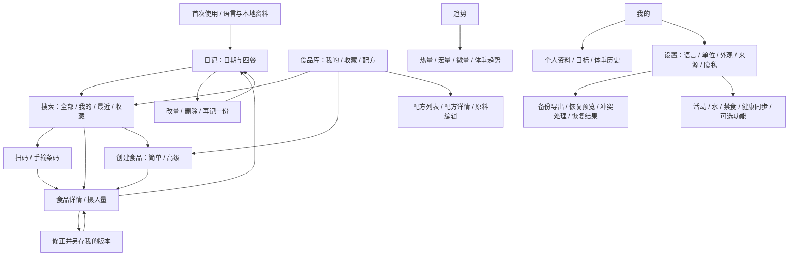

# M1：核心记录流程与界面设计提案

日期：2026-10-15。状态：**第三版修正份量换算与控件外观，待确认，未进入 M2 正式 Flutter UI 改造。**

## 1. 已确认的产品范围

用户接受免费公共数据源覆盖的局限，缺失或错误的数据由自己补充；不以中国食品全覆盖作为开发前提，不为补齐覆盖率引入付费接口。免费数据、本地自建和手动核对是主线。USDA 数据通过直连还是可分发的本地基础库提供，属于后续需要核验覆盖、许可与实现成本的技术选择，M1 不假定已有新接口。

用户已授权继续推进开发，本轮进入 M1。此前暂不安装 Flutter SDK 的决定仍有效；M0 本机编译、测试和设备运行验证保持延期，不能因进入设计阶段而标记通过。

用户暂时无法描述 YAZIO 中不满意的具体操作，选择等功能确认时再讨论。因此本轮依据已明确的流程需求设计，不声称已经复刻或验证 YAZIO 的实际交互，也没有使用其图标、截图、插画等专有素材。

### 已确认的用户反馈（第三版修正）

- 创建食品时单位与每份分量直接显示，不放入折叠的后置选项；包装食品可按盒、包、杯等记录。
- 营养基准和每份物理分量必须独立：无论营养按每100g、每100mL或每份填写，都直接提供“1份对应多少g/mL”的编辑。记录时可用0.5份、1.5份或任意克数/毫升数，并双向换算；选择每份营养不能隐藏或清除重量。缺换算数据时明确显示未知，不猜重量。
- 数字框和下拉框采用同样的外框高度、边距和自绘外观，避免原生控件内部绘制尺寸不一致。
- 首页四餐默认仅显示餐次名称、总热量和添加入口；点击餐次再展开食品明细，保留改量/删除/重复记录能力。
- 用户表示其他部分目前可以；尚未将其解释为最终核心原型确认或 M2 授权。

## 2. 完整页面结构

建议的四个主导航：**日记、食品库、趋势、我的**。日记同时承担当天与历史日期查看，避免首页和另一页日记重复显示当天。原版的日期边界、自定义每日开始时间和历史目标语义继续保留，不因导航合并改变。

这是待确认的信息架构；首版原型仅展开四个核心页面，其余在文档中定位。水、活动和禁食等现有能力没有从代码删除；是否作为可选入口露出，在后续设置设计时决定。

## 3. 核心流程及状态

### 搜索并记录

日记餐次“＋” → 同页搜索、看食品行的热量/基准/来源 → 详情核对 → 输入摄入量 → 添加回原日期餐次。有每份换算时默认一盒/包等份量，无换算则沿用 g/mL。详情可切换计量单位，**只提供已有换算依据的单位**。

空查询显示常用/最近；输入时允许本地单字查询；个人已核对食品优先，再是其他自建和公共结果。最近食品可以按上次份量快速添加，立即给出撤销；未有上次份量的食品先进入详情。公共来源慢、失败或离线时，本地结果应独立可见。

原型搜索为本地模拟，切换外部评审控件可演示离线/公共失败。没有真正查询 USDA、OFF 或 Supabase。扫码仅展示取景与手输条码流程，不调用摄像头。

### 未找到或公共数据缺失

保留搜索词 → 一步进入自建 → 填名称、基准和标示热量，其他未知值可留空 → 保存食品资料 → 同页详情确认这次摄入量 → 添加。创建界面不再额外弹“确定创建？”对话框。

食品模板保存与当前入账明确分开。首版建议“保存并继续记录”，避免填的是每100基准却误把它当成实际吃掉的量。如果用户希望更少一步，下一轮可将摄入量并入表单底部；优点是快，代价是同时处理营养基准与摄入量，更容易混淆。原型先保证含义清楚。

### 修正数据与修改记录

- 公共食品修正：另建我的版本，保留原始来源/条目关系，不向公共库写入，也不自动核验。
- 自建食品编辑：更新以后使用的模板；已经记录的日记保存营养快照，不追溯改写。
- 日记改量：只改变这条记录的摄入量及当天合计。
- 删除：立即执行，提供可撤销提示；不以重复确认弹窗阻断日常操作。
- 再记一份：生成独立记录，保持原餐次、日期、食品快照和份量，可撤销。

### 个人核对与数据来源

“公共数据”“我的食品”“我已核对”分别表达来源类别与个人动作；收藏只表示常用。个人核对必须有来源类型、说明与核对时间，不能因为是自建、收藏或来自某数据库就自动产生核验状态。界面不做无依据的“98%可信”评分。

首版原型内的已有核对标记都是明确标注的演示状态；不是已核验的真实食品库。空值显示“—”，真实零显示“0”。

## 4. 两个可比较的视觉方向

两个方向共享相同信息结构，避免同时更换颜色、布局和流程而无法判断偏好。推荐先体验 **青绿·清晰**。

| 项目 | 青绿·清晰（建议首选） | 暖白·柔和 |
| --- | --- | --- |
| 背景 | 冷中性浅灰绿，白色食品行 | 暖白，米色轻分隔 |
| 强调色 | 深青绿 #1F7057 | 棕金 #80602F |
| 感受 | 读数和状态明确、轻量工具感 | 温和、阅读负担低 |
| 优点 | 主要动作清楚，配合紧凑列表 | 长时间看表单比较柔和 |
| 代价 | 与常见健康工具的绿色品类接近，原创性主要由结构和细节体现 | 警告色需要严格区分，避免和主色混淆 |

采用紧凑数字热量摘要，不用占据首屏的大圆环。蛋白质、脂肪、碳水是一个区域内的三列进度，不再各做独立卡片。首页餐次默认只显示名称和总热量，点击展开后用连续食品行呈现明细；照片只承担识别用途。

## 5. 统一设计系统提案

### 颜色与外观

| 语义 | 青绿浅色 | 青绿深色 | 使用位置 |
| --- | --- | --- | --- |
| 画布 | #F5F7F6 | #131C18 | 页面背景 |
| 表面 | #FFFFFF | #1C2821 | 输入、食品列表和底部操作区 |
| 主文字 | #1E3029 | #E9F0EB | 名称、主要数字 |
| 次文字 | #62716A | #B0BFB5 | 基准、单位、来源 |
| 主要动作 | #1F7057 | #91D7B0 | 保存、添加、选中状态 |
| 动作上文字 | #FFFFFF | #103424 | 主按钮内容 |
| 蛋白质 | #2C7773 | #89CEC1 | 进度条 |
| 脂肪 | #AB752E | #DFB275 | 进度条 |
| 碳水 | #6B6DAA | #B7B4EC | 进度条 |
| 警告文字/背景 | #7D5516 / #FCF2DF | #E7C98C / #3A3020 | 缺数据、来源失败 |
| 删除 | #B64439 | #FFA49B | 删除记录 |

深色不是对浅色截图机械反转。先在主色/文字的实际背景上验证对比度；营养素类别不只靠颜色，还始终带名称和数值。是否允许 Android 动态配色，留待原型确认后决定，避免动态色破坏营养素颜色含义。

### 字体、间距、形状与素材

- 中文使用 Android 系统无衬线字形，数字采用同系统字体和等宽数字特性。浏览器原型在 macOS 使用系统中文字体作近似，不宣称它就是 Android 真机字形。
- 字号层级建议：核心热量30–34、页面标题21、食品名14–16、正文14、辅助11–12。原型可切换1.2倍字号；Flutter 实现必须继续遵循系统文本缩放。
- 间距：4/8/12/16/24/32；页面左右16–18；食品行72左右，长名称截断，详情允许换行。触控区域以 Android 48dp 为目标，紧凑样式也不能挤占点击区。
- 圆角：输入10、缩略图11、列表16、摘要20；按钮12。避免所有层级都用大胶囊或过度嵌套卡片。
- 输入与下拉在正常字号下采用统一48px外框及自绘箭头，随字号一起增高；同排控件实测高度与顶部齐平。
- 主按钮固定在当前页面底部操作区；不叠加漂浮的第二个同类动作。键盘出现时应保留输入与主要操作，长表单正文可以滚动。
- 食品列表图片48×48；日记46×46；详情98×98。没有图片用统一占位符，不自动下载搜索引擎图片。
- 原型图标为本轮原创的简洁线性图形；Flutter 可映射现有 Material 图标，保持同一线宽与尺寸体系。最终 App 图标和名称未确定。
- 动画只用于短状态反馈，约100–180ms；不循环、不拖延保存，尊重减少动态效果设置。原型不依靠动画表达功能。

## 6. 四个核心页面

| 页面 | 信息优先级 | 常驻动作 | 空态/异常 |
| --- | --- | --- | --- |
| 日记 | 日期 → 目标/已摄入/剩余 → 三大营养素 → 四餐名称与总热量（默认收起明细） | 各餐次加号；点击餐次展开，再点食品改量 | 该餐未记录；日期无记录 |
| 搜索 | 搜索框/扫码 → 我的/最近/收藏 → 名称、热量、基准、来源 | 新建；选份量；最近按上次量加 | 无结果；离线；公共来源失败；营养缺失 |
| 详情 | 名称/图片/品牌 → 营养基准 → 本次热量与宏量 | 摄入量、单位、添加/保存修改 | 没有份量换算；未知营养；热量缺失则补充后记录 |
| 编辑 | 名称/品牌/图片 → 明确基准 → 直接编辑记录单位与每份分量 → 标示热量/宏量 | 底部保存；简单/高级切换 | 未填必填项；负数；核对无依据；未知值留空 |

创建食品的“记录单位与份量”在简单模式直接显示；条码和来源仍可折叠。按每份营养录入时仍显示名称、每份重量/容量和单位；1份=150g时支持0.5份=75g、1.5份=225g，数值与营养双向换算。缺重量则明确提示且不提供无依据的克数选项。已有日记仍保留记录时的份量换算快照。详情的来源和高级营养素折叠；它们不挡住日常输入量。简单/高级切换仅改变可见字段，不清空、重缩放或覆盖已有营养数值。原型高级模式覆盖现有模型24个字段；没有把“维生素”泛称为包含所有已知维生素。B1/B2/E/K、叶酸等额外项目若后续需要，应另做兼容扩展与录入设计。

能量校验在原型只展示4/4/9估算与标示值之差；不设置新的强制误差阈值，不宣称能校验全部标签口径。原型也不自行定义纤维、糖醇或酒精的统一规则。M3 再整理来源口径、容差和提示条件，并保护既有计算。

## 7. 需求到阶段的覆盖矩阵

| 需求 | 原型覆盖 | 正式实现/验收阶段 |
| --- | --- | --- |
| 日期、目标/摄入/剩余、三大营养、四餐 | 可操作示例 | M2，接回既有目标和汇总 |
| 名称/份量/热量/图片、改量/删除/重复 | 可操作，带撤销 | M2，日记与汇总一致性测试 |
| 中文搜索/单字/我的/最近/收藏优先 | 本地示例筛选 | M2/M3，真实输入、排序和持久化 |
| 多来源合并/去重 | 原型按稳定ID保留食品，无激进同名合并 | M3，品牌/生熟/规格回归 |
| 国内外条码 | 取景示意、样例/手输，未调用相机 | M2 接既有扫描器；M5 真机 |
| 无结果快速创建 | 可操作，保留查询名称 | M2 |
| 自建/另存修正版/核对/收藏分离 | 示例状态与来源表单 | M3 兼容 schema、稳定ID、导入导出 |
| 图片 | 本地预览，已有开源项目示例素材 | M2/M4 存储与备份，M5 权限 |
| 每100g/每100mL/每份 | 示例选择、换算；无密度不混换 | M2/M3 适配现有计量 |
| kcal/kJ | 详情显示与编辑输入切换 | M2/M3 回归数值精度 |
| 宏量、糖/纤维/钠、矿物质/维生素 | 现有24字段可录入，简单/高级不丢值 | M2/M3，其他字段需兼容扩展 |
| 热量一致性及纤维/取整差异 | 展示估算差异；不强制覆盖 | M3 明确口径与容差 |
| 来源/可信度、不无依据核验 | 来源、个人核对、缺失分别显示 | M3，核对证据与迁移 |
| 深色、布局/输入一致性 | 两方向、浅深色、1.2倍字号 | M2 组件截图；M5 TalkBack和系统字号 |
| 本地备份/恢复、CSV交换 | 结构和状态已规划，未伪装实现 | M4，完整性、幂等和失败回滚 |
| 趋势/资料/设置 | 信息架构已定位，核心原型未展开 | M4 |
| 免费/无广告/无订阅/隐私 | 原型无外部请求、追踪或收费入口 | 各阶段依赖/流量核查 |
| iOS合理成本兼容 | 没有改平台工程 | M2尽量平台无关；M5单列iOS边界 |
| GPL及原创视觉 | 保留许可证，原创布局/图标，素材署名 | 每次源码/APK交付 |

## 8. 原型运行与明确限制

入口为 [prototype/index.html](prototype/index.html)。可直接用浏览器打开本地文件，或通过项目本地预览服务访问。所有脚本、样式与图片均来自本地；无需 npm 项目、编译、登录、API key 或网络食品接口。

操作数据存于当前标签页 sessionStorage 的独立命名空间；重置只清本原型的示例状态，不接触 Android App 数据。直接打开本地文件时，浏览器若不提供 sessionStorage，仍可在当前页面内存里演示，不承诺刷新后保留。

原型不是 APK，也不是 Flutter 页面；代码不进入 lib/android/ios。它只验收信息结构、视觉与操作流程。真实搜索、扫描、Hive写入、营养目标、完整备份、设备权限、Android键盘和TalkBack必须在后续阶段验证。

### 示例素材来源

复用原项目 `assets/demo/meals/` 已有照片及其署名；不下载新图片、不使用 YAZIO 素材。原型营养数字主要沿用原项目 demo 数据，仅作交互示例，不与照片中的实际食品构成对应。

| 示例 | 摄影师 | Unsplash 图片ID |
| --- | --- | --- |
| 燕麦粥 | Alexandru Acea | 1548807371-30dc1bbe6cb5 |
| 糙米饭 | bady abbas | 1593357849627-cbbc9fda6b05 |
| 鸡胸肉 | joe boshra | 1762631934518-f75e233413ca |
| 希腊酸奶 | micheile henderson | 1571212515416-fef01fc43637 |
| 苹果 | Shelley Pauls | 1567306226416-28f0efdc88ce |
| 西兰花 | Mick Haupt | 1646161762904-043f71f256f1 |
| 杏仁 | Towfiqu barbhuiya | 1627820752174-acae1b399128 |

原项目署名依据：`lib/core/utils/demo/unsplash_attribution.dart`。照片遵循其 Unsplash 许可说明，源码继续 GPL-3.0；不把照片许可证改称 GPL。

## 9. 待用户体验后的决定

1. 更偏好青绿·清晰还是暖白·柔和；是否保持紧凑数字摘要。
2. 是否接受“日记兼任当天/历史、食品库为独立入口”的四导航。
3. 食品资料保存后再确认摄入量，是否足够高效，还是要在表单内直接完成本次记录。
4. 在四页真实走查中指出不顺手的位置，再确定最终布局。

核心原型确认前不开始 M2 大规模改造；不要求用户现在能用专业设计语言描述问题。
